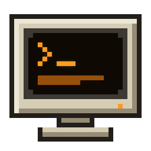

<p align="center"></p>

# CRT Terminal Themes

Turn your everyday terminal into a glowing CRT, and pick the screen of a real historic machine: a DEC VT100,
an Apple ][, a Commodore 64, an IBM 3278 mainframe terminal, a Teletype on paper, a ZX Spectrum on a TV and 39 more.

* **Windows:** [Windows Terminal](https://aka.ms/terminal), with a CRT pixel shader, matching window colours,
  theme switching from Settings, and optional CRT-styled menus.
* **macOS and Linux:** [Ghostty](https://ghostty.org), with the same shader in GLSL and a `crt-theme` command.

The CRT effect is a port of **[cool-retro-term](https://github.com/Swordfish90/cool-retro-term)**'s shaders
(glow, scan lines, static noise, flicker, the rolling bright band, rasterisation, RGB fringing and the screen bulge),
so the looks are cool-retro-term's, running inside the terminal you already use. See [Credits](#credits).

## Install

### Download and double-click

From the [latest release](https://github.com/SnortingPixels/crt-terminal-themes/releases/latest):

| System | File | First run |
|---|---|---|
| Windows 10/11 | `CRT-Terminal-Setup.exe` | Windows SmartScreen may warn about an unknown publisher (the installer isn't code-signed): **More info, then Run anyway**. |
| macOS | `Install-CRT-Terminal-macOS.zip`, then `Install CRT Terminal.command` | macOS may block an unsigned script: **right-click it, then Open**. |
| Linux | `install-crt-terminal.sh` | Run it, or in your file manager choose *Run as a program*. |

### One line in a terminal

Windows (PowerShell):

```powershell
irm https://raw.githubusercontent.com/SnortingPixels/crt-terminal-themes/main/install.ps1 | iex
```

macOS / Linux:

```sh
curl -fsSL https://raw.githubusercontent.com/SnortingPixels/crt-terminal-themes/main/install.sh | bash
```

Everything installs for your user only. Nothing needs admin rights except the optional Windows menu styling.

### What gets installed

* **Shaders and theme list:** `%LOCALAPPDATA%\CRT-Terminal` on Windows, `~/.local/share/crt-terminal` on macOS/Linux.
* **Fonts**, for your user only. They are downloaded from their authors' original sources and never bundled here.
  The ZX Spectrum, Amstrad CPC and BBC teletext fonts are **built on your machine** from each computer's own
  character data (ROM / character-generator data from emulator projects), which needs Python 3. Without Python
  those three themes fall back to another font.
* **Windows Terminal:** one colour scheme, one window theme per CRT theme, the default-profile settings, and a small
  hidden helper that starts with Windows. A backup of `settings.json` is made first.
* **Ghostty:** one line at the end of your Ghostty config (`config-file = ?~/.config/crt-terminal/current.conf`)
  and the `crt-theme` command in `~/.local/bin`.
* **Optional on Windows: CRT-styled menus.** The new-tab dropdown, right-click menus and tooltips are recoloured
  to match the theme by a [Windhawk](https://windhawk.net) mod. Tick the box in the setup wizard, or use
  `$env:CRT_MENUS='1'` with the one-liner. It installs Windhawk and asks for admin.

## Use

### Windows

* **Settings, Appearance, Theme, "Retro · …"** switches everything: shader, colours, font, cursor and window colours.
* While Windows Terminal is in front:
  * **Ctrl+Alt+T** next theme, **Ctrl+Alt+Shift+T** previous theme.
  * **Ctrl+Alt+B** historic screen bulge on/off. A bulge moves text slightly away from where Terminal places the mouse
    and selection, so turn it off when you need exact selection.
* Picking a normal theme (Dark, Light, System) turns the CRT look off.
* Restart Windows Terminal once after installing so it loads the new fonts.

### macOS / Linux (Ghostty)

```sh
crt-theme list                 # all 45 themes
crt-theme set "Commodore 64"   # pick one
crt-theme next                 # or prev
crt-theme bulge off            # flat screen (bulge on = historic)
```

`crt-theme` asks running Ghostty windows to reload their config. If one doesn't change, use Ghostty's
*Reload Configuration* (macOS: Cmd+Shift+, ; Linux: Ctrl+Shift+,).

## Themes

Historic themes use each machine's documented phosphor or palette colours where a source exists (MAME's phosphor
tables, emulator palettes, manufacturer documentation), and fonts traced from the machine's own character ROM
wherever one exists. Values that could only be estimated are marked "estimate" in `themes/themes.json`.
The cool-retro-term themes copy that app's own built-in profiles.

| Theme | Look / source | Font | Colours | Bulge |
|---|---|---|---|---|
| Default Amber | cool-retro-term profile | Terminess Nerd Font Mono | `#ff8100` on `#000000` | 0.2 |
| Monochrome Green | cool-retro-term profile | DepartureMono Nerd Font Mono | `#0ccc68` on `#000000` | 0.3 |
| Deep Blue | cool-retro-term profile | BigBlueTerm437 Nerd Font Mono | `#7fb4ff` on `#000000` | 0.4 |
| Neon Cyan | cool-retro-term profile | IosevkaTerm Nerd Font Mono | `#52f7ff` on `#001018` | flat |
| Plasma | cool-retro-term profile | FiraCode Nerd Font Mono | `#ff9bd6` on `#070014` | flat |
| Ghost Terminal | cool-retro-term profile | JetBrainsMono Nerd Font Mono | `#a6b3c0` on `#0b1014` | flat |
| Boring | cool-retro-term profile | JetBrainsMono Nerd Font Mono | `#ffffff` on `#000000` | flat |
| E-Ink | cool-retro-term profile | Hack Nerd Font Mono | `#101010` on `#f2f2ec` | flat |
| DEC VT100 | P4 white, Glass TTY VT220 font | Glass TTY VT220 | `#b4d8ff` on `#05070a` | 0.3 |
| DEC VT220 Amber | P3 amber, Glass TTY VT220 font | Glass TTY VT220 | `#ffa700` on `#0a0600` | 0.3 |
| DEC VT220 Green | P1 green, Glass TTY VT220 font | Glass TTY VT220 | `#33ff66` on `#020a04` | 0.3 |
| Zenith Z-19 | green, Heathkit-H19 ROM font | Heathkit-H19 Regular | `#33ff66` on `#020a04` | 0.3 |
| IBM 5151 MDA | P39 green, IBM VGA ROM font | PxPlus IBM VGA 8x16 | `#33ff66` on `#020803` | 0.3 |
| IBM PC CGA | 5153 colour, IBM 8x8 ROM font | PxPlus IBM EGA 8x8 | `#aaaaaa` on `#000000` | 0.3 |
| IBM 3278 | green, IBM 3270 font | 3270 Nerd Font Mono | `#3cff7a` on `#000000` | 0.2 |
| IBM P70 Plasma | orange gas plasma, VGA ROM font | PxPlus IBM VGA 8x16 | `#ff6a1a` on `#140500` | flat |
| Apple ][ | green monitor, Apple II ROM font | Print Char 21 | `#33ff66` on `#010a03` | 0.5 |
| Commodore PET | P4 white, PET ROM font | Pet Me | `#b4d8ff` on `#04060a` | 0.7 |
| Commodore 64 | Pepto palette, C64 ROM font | Pet Me 64 | `#6c5eb5` on `#352879` | 0.5 |
| Atari 800 | default blue, Atari ROM font | Atari Classic | `#8ed6ff` on `#0f1f5a` | 0.4 |
| Amiga 500 | Workbench 1.3 palette, Topaz font | Topaz a500a1000a2000 | `#ffffff` on `#0055aa` | 0.3 |
| Tektronix 4014 | storage tube, tek4010 emulator colours | DepartureMono Nerd Font Mono | `#24b324` on `#001400` | 0.15 |
| Xerox Alto | ContrAlto colours, Alto Mono font | Alto Mono | `#000000` on `#ffffff` | 0.2 |
| Sun SPARCstation 20 | Sun console, Gallant font | Gallant Raster Term | `#000000` on `#ffffff` | 0.1 |
| SGI Indigo2 | IRIX winterm colours | DepartureMono Nerd Font Mono | `#feffdd` on `#00004d` | 0.1 |
| SGI Octane | IRIX 6.5 winterm colours | DepartureMono Nerd Font Mono | `#feffdd` on `#00004d` | 0.1 |
| NeXTcube | MegaPixel greyscale (estimate) | DepartureMono Nerd Font Mono | `#000000` on `#e6e6e6` | 0.15 |
| Cray-1 | DG maintenance console (estimate) | Glass TTY VT220 | `#33ff66` on `#001000` | 0.3 |
| IBM System/360 | IBM 2260 display (estimate) | 3270 Nerd Font Mono | `#40ff40` on `#001400` | 0.4 |
| DEC PDP-11 | VT100 console, Glass TTY font | Glass TTY VT220 | `#e8f0ff` on `#050505` | 0.3 |
| Apollo DN10000 | Display Manager pads (estimate) | DepartureMono Nerd Font Mono | `#000000` on `#f0f0f0` | 0.15 |
| IBM 5100 | built-in 5-inch CRT (estimate) | 3270 Nerd Font Mono | `#e0ffe8` on `#000000` | 0.6 |
| Altair 8800 | ASR-33 teletype paper | Teletype33 | `#1a1a1a` on `#f3ecd2` | flat |
| IMSAI 8080 | ASR-33 teletype paper | Teletype33 | `#1a1a1a` on `#f3ecd2` | flat |
| Amiga 1000 | Workbench 1.x palette, Topaz font | Topaz a500a1000a2000 | `#ffffff` on `#0055aa` | 0.3 |
| Apple Lisa | LisaTerminal font | LisaTerminal Paper 2X3Y | `#000000` on `#ffffff` | 0.2 |
| GRiD Compass | amber EL panel | DepartureMono Nerd Font Mono | `#ff9a1f` on `#140800` | flat |
| Symbolics 3600 | Genera console (estimate) | DepartureMono Nerd Font Mono | `#000000` on `#e8eee8` | 0.15 |
| Thinking Machines CM-5 | red LED panel | DepartureMono Nerd Font Mono | `#ff2a1a` on `#0a0000` | flat |
| DEC VT320 Amber | P3 amber, VT323 font | VT323 | `#ffa700` on `#0a0600` | 0.3 |
| MS-DOS Norton Blue | VGA palette, IBM VGA ROM font | PxPlus IBM VGA 8x16 | `#55ffff` on `#0000aa` | 0.3 |
| Hercules Amber | P3 amber, IBM VGA ROM font | PxPlus IBM VGA 8x16 | `#ffa700` on `#0a0600` | 0.3 |
| ZX Spectrum | TV, ROM character set | ZX Spectrum ROM | `#000000` on `#cdcdcd` | 0.4 |
| Amstrad CPC 464 | firmware colours, ROM character set | Amstrad CPC ROM | `#ffff80` on `#000080` | 0.3 |
| BBC Micro Teletext | Mode 7, SAA5050 characters | BBC Teletext SAA5050 | `#ffffff` on `#000000` | 0.35 |

*Bulge* is the screen curvature on cool-retro-term's 0 to 1 scale: strong for small 1970s/80s tubes, slight for flat
Trinitron screens, none for flat panels, LEDs and paper.

All themes share one character cell (12×26 px at 100 % scaling), so switching themes never changes the number of
columns and rows. Running programs keep their layout. Fonts that are wider than they are tall, like the 8×8 home
computer fonts, are drawn smaller to fit.

## Limits

* **No burn-in (ghost trails).** Terminal shaders can't read the previous frame.
* **The CRT effect applies to the terminal text only.** Windows Terminal's Settings page is a normal Windows window.
  It is left as it is; the optional menu styling covers the menus, tooltips and tab bar.
* **The installers aren't code-signed** (signing certificates cost money), hence the first-run warnings above.
* **Ghostty** is tested by compiling every shader with glslang, the compiler Ghostty uses, and by running the
  installer, `crt-theme` and the uninstaller. Reports from real macOS and Linux machines are very welcome.

## Uninstall

* **Windows:** Settings, Apps, *CRT Terminal Themes*, Uninstall. Or run
  `%LOCALAPPDATA%\CRT-Terminal\uninstall.ps1`. Windows Terminal's settings are restored from the install backup.
* **macOS / Linux:** `bash ~/.local/share/crt-terminal/uninstall.sh`

Fonts stay installed, because other apps may use them. Remove them from your system's font settings if you like.

## Build it yourself

```sh
pip install fonttools
python src/build.py          # themes/themes.json + src/template.{hlsl,glsl}  ->  dist/
```

`dist/` is committed, so the installers need no build step. The release workflow rebuilds it, checks every shader
(HLSL with the Windows shader compiler, GLSL with glslang) and builds the downloadable installers.

To add or change a theme, edit `themes/themes.json` and run the build.

## Credits

* **[cool-retro-term](https://github.com/Swordfish90/cool-retro-term)** by **Filippo Scognamiglio (Swordfish90)
  and the cool-retro-term contributors**, GPL-3.0. The CRT shader here is a port of its `terminal_dynamic.frag` and
  `terminal_static.frag`, and eight of the themes are its built-in profiles. Without their work none of this would exist.
  The idea of bringing it to Windows came from
  [cool-retro-term-windows](https://github.com/pushingpandas/cool-retro-term-windows) by pushingpandas.
* **Windows menu styling:** built on the
  [Windows 11 Settings Styler](https://github.com/ramensoftware/windhawk-mods) engine by **m417z** (Windhawk, GPL-3.0).
* **Phosphor colours:** [MAME](https://github.com/mamedev/mame)'s phosphor profiles.
* **Character data for the built fonts:**
  * The ZX Spectrum 48K and Amstrad CPC 464 ROMs, as distributed with emulators. Amstrad allows the distribution of
    its ROMs for emulation.
  * The SAA5050 teletext characters from [jsbeeb](https://github.com/mattgodbolt/jsbeeb) /
    [b-em](https://github.com/stardot/b-em).
* **Fonts**, downloaded from their authors and used under their own licences:
  * Terminus/Terminess, Departure Mono, BigBlue Terminal, Iosevka, Fira Code, JetBrains Mono, Hack (Nerd Font builds).
  * [Print Char 21, Pet Me, LisaTerminal](https://www.kreativekorp.com/software/fonts/) (Kreative Software).
  * Atari Classic (Mark Simonson).
  * [Px437/PxPlus IBM fonts](https://int10h.org/oldschool-pc-fonts/) (VileR, int10h.org).
  * [IBM 3270](https://github.com/rbanffy/3270font) (Ricardo Bánffy).
  * [Glass TTY VT220](https://github.com/svofski/glasstty) (svofski).
  * [Heathkit-H19](https://github.com/scruss/HeathkitH19Font) (Stewart Russell).
  * [Topaz](https://github.com/rewtnull/amigafonts) (rewtnull).
  * [Gallant](https://github.com/NanoBillion/gallant) (Sun console font).
  * [Teletype33](https://github.com/progs-n-things/Teletype33-Font).
  * [Alto Mono](https://damieng.com/typography/) (Damien Guard).
  * [VT323](https://github.com/google/fonts/tree/main/ofl/vt323) (Peter Hull).

## License

[GPL-3.0](LICENSE), like cool-retro-term, whose shader code this is derived from. Fonts and ROM data are not part of
this repository; they keep their own licences.
